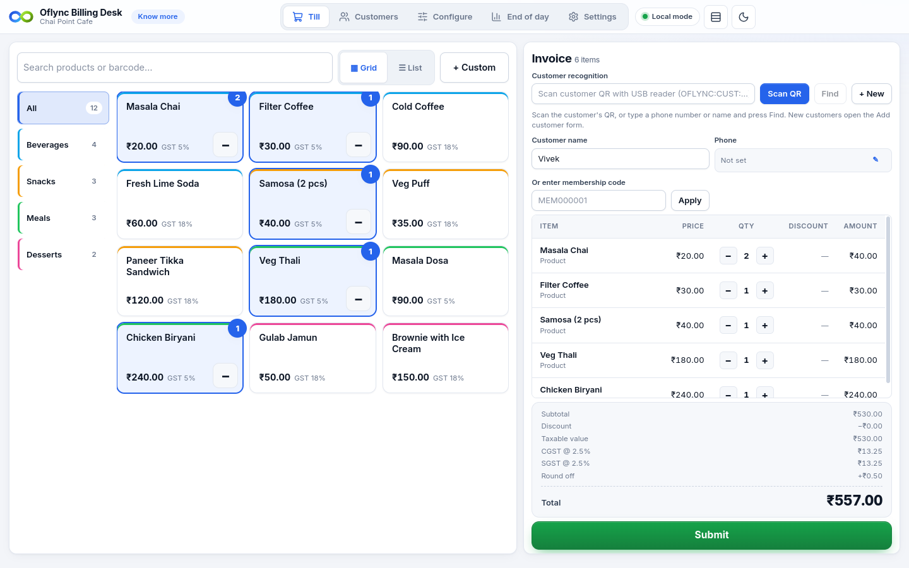
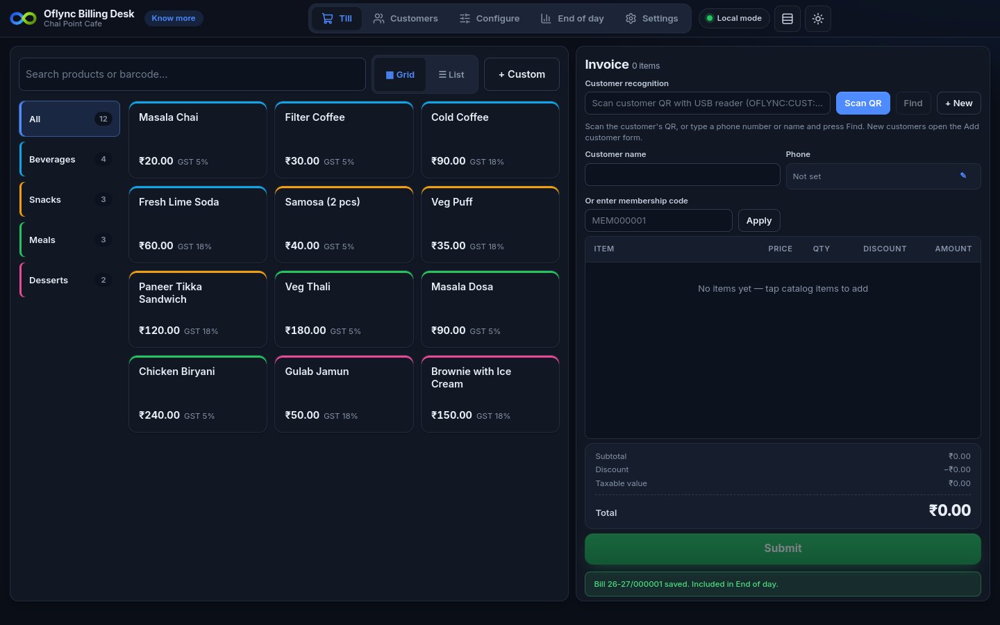
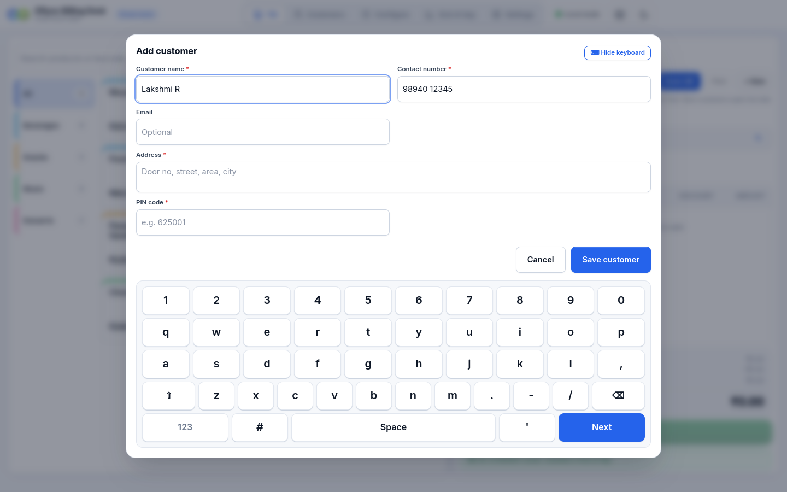
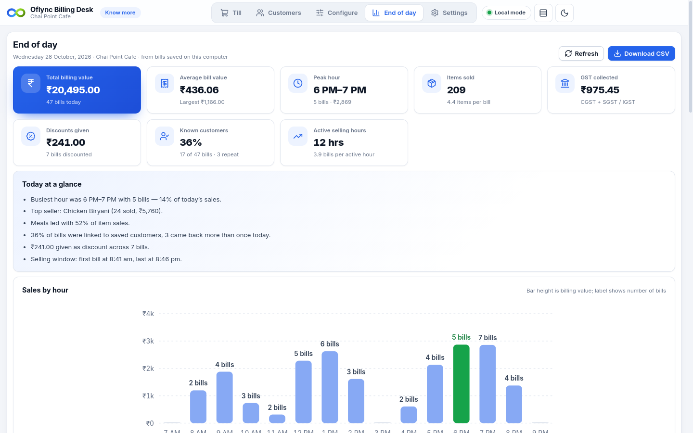
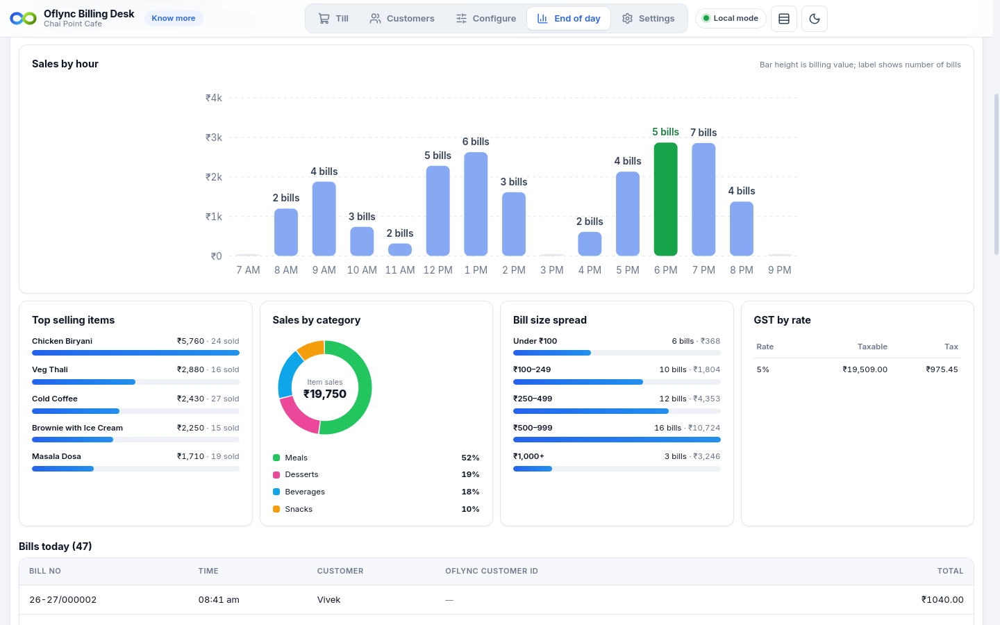
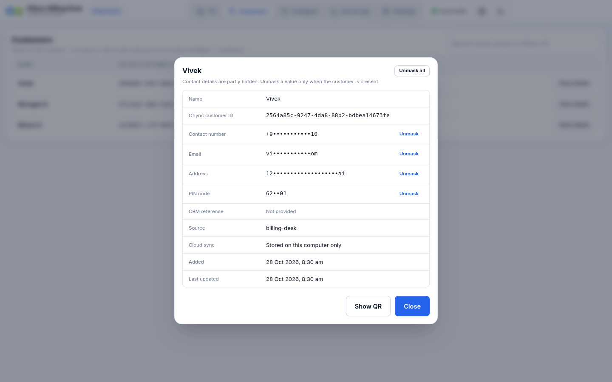
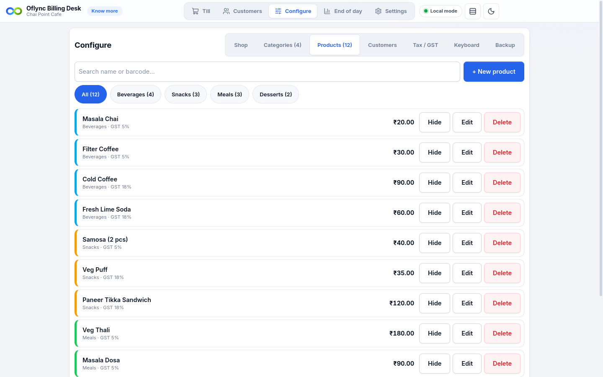

# Oflync app downloads

Installers for Oflync apps. The files are attached to **[Releases](https://github.com/oflync/app-dist/releases)**, not stored in this repository.

## Oflync Billing Desk — free, offline billing for small shops

A free billing counter for small and medium businesses: GST receipts, USB/network thermal printing, customers with QR cards, end-of-day insights and backups. It works fully offline, and all data stays on the shop's computer.



**Latest version: 0.1.0-beta.1** — [release page](https://github.com/oflync/app-dist/releases/tag/0.1.0-beta.1) · [full guide and FAQ](https://docs.oflync.com/docs/billing-desk)

- **Free** — no licence fee, subscription or per-bill charge
- **Offline** — billing, printing and reports work without the internet; nothing is sent to Oflync servers
- **GST ready** — CGST + SGST / IGST per item, GSTIN on receipts, or no GST if you are not registered
- **Thermal printing** — ESC/POS printers over USB or LAN, 58 mm or 80 mm paper
- **Customers** — QR cards for regulars, with phone, email and address masked on screen
- **End-of-day insights** — total sales, bills per hour, peak hour, top items, categories and GST, plus CSV export
- **Touch friendly** — on-screen keyboard, barcode/QR scanners, light and dark themes

### Download

Each download is a `.zip` with one installer inside.

| Platform | Download |
|----------|----------|
| Ubuntu / Debian (recommended for Linux) | [Oflync-Billing-Desk-0.1.0-beta.1-linux-amd64.zip](https://github.com/oflync/app-dist/releases/download/0.1.0-beta.1/Oflync-Billing-Desk-0.1.0-beta.1-linux-amd64.zip) |
| Other Linux (portable AppImage) | [Oflync-Billing-Desk-0.1.0-beta.1-linux-x86_64_AppImage.zip](https://github.com/oflync/app-dist/releases/download/0.1.0-beta.1/Oflync-Billing-Desk-0.1.0-beta.1-linux-x86_64_AppImage.zip) |
| Windows 10/11 (64-bit) | [Oflync-Billing-Desk-0.1.0-beta.1-win-x64.zip](https://github.com/oflync/app-dist/releases/download/0.1.0-beta.1/Oflync-Billing-Desk-0.1.0-beta.1-win-x64.zip) |

### Install on Ubuntu / Debian

```bash
cd ~/Downloads
wget https://github.com/oflync/app-dist/releases/download/0.1.0-beta.1/Oflync-Billing-Desk-0.1.0-beta.1-linux-amd64.zip
unzip Oflync-Billing-Desk-0.1.0-beta.1-linux-amd64.zip
sudo apt install ./Oflync-Billing-Desk-0.1.0-beta.1-linux-amd64.deb
```

Open **Oflync Billing Desk** from the app menu, or run `oflync-billing-desk`.

To use a USB receipt printer, give your user access once, then log out and back in:

```bash
sudo usermod -aG lp $USER
```

### Run the AppImage (other Linux)

```bash
unzip Oflync-Billing-Desk-0.1.0-beta.1-linux-x86_64_AppImage.zip
chmod +x Oflync-Billing-Desk-0.1.0-beta.1-linux-x86_64.AppImage
./Oflync-Billing-Desk-0.1.0-beta.1-linux-x86_64.AppImage
```

On Ubuntu 23.10 and newer, use the `.deb` instead, or add `--no-sandbox` to the last command.

### Install on Windows 10/11

1. Right-click the downloaded zip and choose **Extract All…**.
2. Run `Oflync-Billing-Desk-0.1.0-beta.1-win-x64.exe`.
3. If you see **"Windows protected your PC"**, click **More info → Run anyway** (the beta is not code-signed yet).
4. Open **Oflync Billing Desk** from the desktop or Start menu.

For a USB receipt printer, share it in **Printer properties → Sharing** (for example as `POS58`) and enter `\\localhost\POS58` in **Settings → Thermal printer**.

### Screenshots

| Billing counter (dark theme) | Add customer with on-screen keyboard |
|---|---|
|  |  |
| **End-of-day summary** | **End-of-day charts** |
|  |  |
| **Customer details (masked)** | **Configure products** |
|  |  |

### Verify your download

| File | SHA-256 |
|------|---------|
| `Oflync-Billing-Desk-0.1.0-beta.1-linux-amd64.zip` | `4d74ae9d9b033dd9c62185f39c3dde531c5a8476b49b6e901b4ce5249adbf73f` |
| `Oflync-Billing-Desk-0.1.0-beta.1-linux-x86_64_AppImage.zip` | `25020a1a0ce60005cf89ea3becbf93427a8e06c4889db77192323b161ad36ae4` |
| `Oflync-Billing-Desk-0.1.0-beta.1-win-x64.zip` | `7fe7931b51c54087edd682c75a17b4dd1bfc8e6a2b61d418607ce895eba173b8` |

Linux: `sha256sum <file>`. Windows (PowerShell): `Get-FileHash <file> -Algorithm SHA256`.

### Help

Setup guide, printer help and FAQ: **[docs.oflync.com/docs/billing-desk](https://docs.oflync.com/docs/billing-desk)** · Support: [support@oflync.com](mailto:support@oflync.com)
